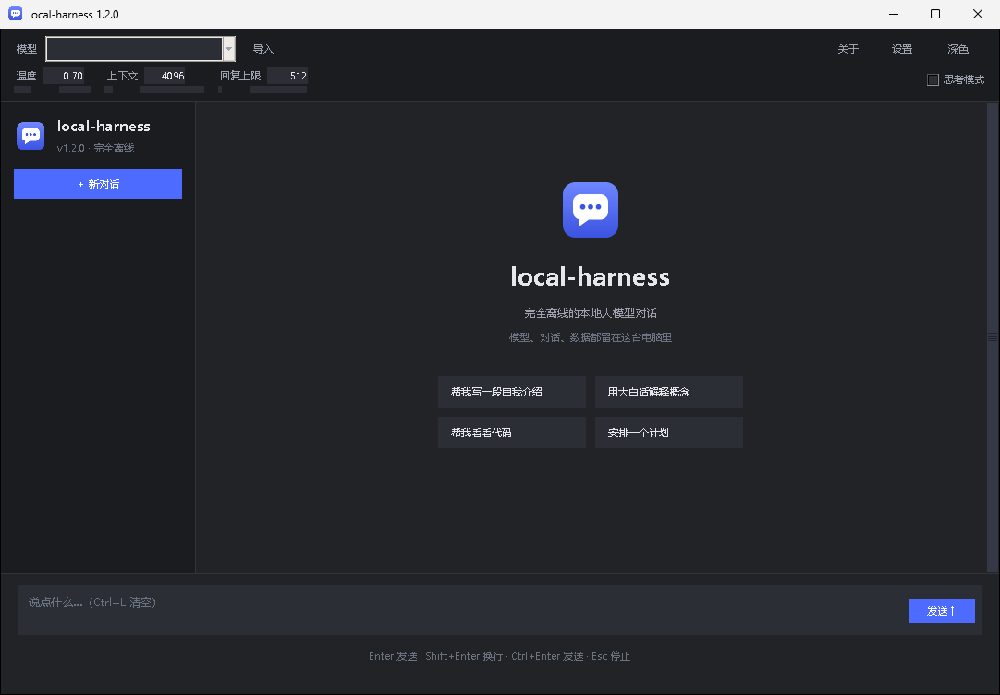
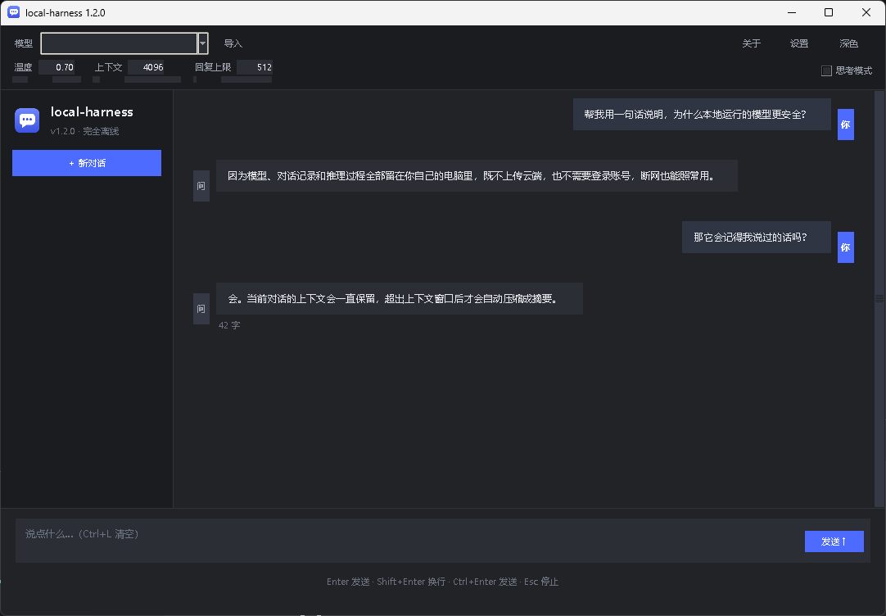

# local-harness

完全离线的本地大模型对话客户端（Windows）。用 Python + tkinter 写界面，用
[llama.cpp](https://github.com/ggml-org/llama.cpp) 在**本机 CPU** 上跑 GGUF 模型：
不联网、不登录、不上传，模型和对话都留在你自己的电脑里。

> 一个 llama-cli 子进程 + stdin/stdout 管道，没有 server、没有 HTTP、没有
> WebView。整个程序里搜不到 socket / http / requests 的调用。

- 许可证：**GNU GPL v3**（见 [LICENSE](LICENSE)）
- 依赖：Python 3.10+（开发）/ 打包后无需 Python
- 第三方：界面与逻辑全部自写，运行时只调用 llama.cpp（MIT）



## 特性

- **纯离线**：断网照常用，程序不含任何联网代码
- **任意 GGUF 模型**：Qwen、Llama、Mistral、Gemma、Phi、DeepSeek、Yi、GLM、
  MiniCPM、SmolLM… 只要 llama.cpp 能跑就行；自动读 GGUF 元数据拿原生上下文上限，
  自动过滤 mmproj / 向量模型 / 分片文件
- **流式输出**：逐字出现，随时「停止」
- **参数实时可调**：温度、上下文窗口、回复上限，输入框直接改数字或拖滑块
- **思考模式**：支持 Qwen3 等推理模型，思考过程不混进正文
- **上下文自动压缩**：超过阈值用 `llama-tokenize` 数 token、临时进程做摘要
- **多会话**：左侧对话列表，重命名、删除、单条消息删除
- **深浅主题**、绿色免安装（可放 U 盘）、单文件 exe 打包



## 目录结构

```
main_gui.py            图形界面入口
main.py                终端界面入口
local_harness/
    brand.py           名称、版本、内嵌图标
    assets.py          定位 llama-cli / 模型（含单文件版 _MEIPASS 支持、模型过滤）
    gguf.py            解析 GGUF 元数据：原生上下文、架构、显示名
    engine.py          子进程驱动 llama-cli：流式状态机、ANSI 过滤、参数探测
    session.py         一次进程承载多轮对话，/read 注入历史
    compressor.py      上下文压缩
    store.py           config.json / chats/*.json
    style.py           深色 / 浅色配色
    gui.py             主窗口、气泡、设置、关于
    ui.py              终端界面
    config.py          配置默认值与读写
    cli.py             命令行参数
tools/
    make_icon.py       生成图标（纯标准库绘制，超采样抗锯齿）
    make_brand.py      把图标 base64 写进 brand.py
    make_splash.py     生成单文件版启动画面
    pack.py            打绿色版目录 / zip
    test_models.py     多模型冒烟测试
    pe_imports.py      查 PE 依赖（排查缺 DLL）
    preview.py         预览某个界面状态
build_gui.spec         PyInstaller：绿色版目录
build_onefile.spec     PyInstaller：单文件 exe（可选内置模型）
version_gui.txt        exe 文件属性
```

## 快速开始（源码运行）

```bash
# 1. 准备 llama.cpp 的 Windows 版，解压到 llama\（需要 llama-cli.exe 和 DLL）
# 2. 把 .gguf 模型放到 model\（或启动后用界面里的「导入」选一个文件夹）
pip install -r requirements.txt   # 无第三方依赖，这一步只是形式
python main_gui.py                # 图形界面
python main.py                    # 终端界面
```

程序目录约定：

```
local-harness.exe / main_gui.py
_internal\      （打包后）Python 运行时
llama\          llama-cli.exe + DLL
model\          *.gguf
chats\          对话记录（自动生成）
config.json     设置（自动生成）
```

## 打包

```bash
# 绿色版目录
pyinstaller build_gui.spec --noconfirm --distpath distgui
python tools/pack.py --zip

# 单文件 exe（llama.cpp 打进去，模型放旁边）
pyinstaller build_onefile.spec --noconfirm --distpath distone

# 单文件 exe + 内置模型（启动时解压，约 15 秒）
set LOCALCHAT_BUNDLE_MODEL=D:\models\Qwen3-0.6B-Q8_0.gguf
pyinstaller build_onefile.spec --noconfirm --distpath distone_model
```

单文件版把资源解包到 `sys._MEIPASS`，`assets.bundle_dir()` 负责在那里找
`llama\` 和 `model\`；`config.json`、`chats\` 仍然落在 exe 旁边，所以
"程序"和"用户数据"是分开的。

## 实现要点

- **流式解析**：识别 `\n> ` 提示符与 `[ Prompt:` 收尾行，行首只留几个字符前瞻，
  判定不是标记就立刻逐字直通；收尾行缺失的实现用"安静 6 秒"兜底。
- **干净输出**：`AnsiFilter` 吃掉 ESC 序列、残留的 `[0m` 片段、控制字符，
  再清掉模型自带的 `<|im_end|>` 之类控制标记，压掉多余空行。
- **兼容各种 llama.cpp**：启动前 `--help` 探一遍，只带上它真正支持的开关，
  老版本缺 `--reasoning` / `--log-disable` 也不会一启动就退出。
- **气泡自适应**：宽度按内容像素宽度换算成字符宽（Tk 的 `-width` 单位是 "0"
  的宽度），高度按 `displaylines` 折行数算，等控件上屏后再量一次。

## 许可

本项目代码以 **GPL-3.0-or-later** 发布，完整条款见 [LICENSE](LICENSE)。

运行时依赖 [llama.cpp](https://github.com/ggml-org/llama.cpp)（MIT），
模型文件由各自发布方授权（例如 Qwen 系列为 Apache-2.0），本仓库不包含任何模型。
